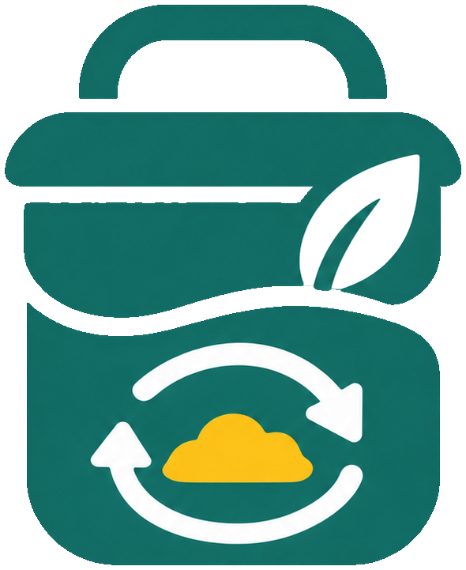

<p align="center"></p>

# RANTANG

**Sistem pencocokan sisa pangan dapur MBG (SPPG) tingkat kelurahan.**
Aplikasi web seluler-pertama (PWA) yang menghubungkan dapur SPPG, kelurahan/LPM, warga penerima, dan pengolah (maggot, kompos). Dua aliran dipisah sejak dapur: **pangan layak untuk warga, sisa piring untuk pengolah.** Wadah pintar berbasis IoT mengirim berat dan suhu sehingga pencatatan cukup tiga ketukan.

> Status: percontohan 3 bulan di 2 SPPG (versi 0.1). Angka target dan batas waktu adalah asumsi yang dikalibrasi bersama mitra.

## Isi repositori

| Folder | Isi |
|---|---|
| `app/` | PWA React + Vite. Berjalan mandiri (mode demo dengan data contoh dan simulator IoT) atau tersambung ke server |
| `server/` | API REST Node.js tanpa dependensi wajib, penerima telemetri IoT (HTTP/MQTT), siaran langsung SSE |
| `firmware/rantang-bin/` | Firmware ESP32 wadah pintar: load cell HX711 + sensor suhu DS18B20 |
| `docs/` | Panduan pengguna (PDF), mockup, video alur sistem, arsitektur |
| `PRODUCT.md`, `DESIGN.md` | Konteks produk dan sistem visual |

## Menjalankan

```bash
# aplikasi (mode demo, tanpa server)
cd app && npm install && npm run dev
# buka http://localhost:5173, masuk dengan kode OTP demo 123456
```

Tautan demo langsung per peran: `?as=sppg`, `?as=penerima`, `?as=pengolah`, `?as=admin`, `?as=pengamat` (tambah `&reset=1` untuk data contoh baru).

```bash
# server API + IoT
cd server && node src/index.js            # http://localhost:8080
node tools/fake-device.js                 # meniru dua ESP32 mengirim telemetri
# sambungkan aplikasi ke server:
cd app && VITE_API_URL=http://localhost:8080 npm run dev
```

## Alur kerja

1. **Pilah**: petugas memisahkan dua wadah pintar (layak dan sisa piring).
2. **Catat**: pilih jenis, berat terisi otomatis dari wadah, centang kelayakan, kirim (tiga ketukan).
3. **Cocokkan**: sistem menawarkan ke penerima terdekat yang aktif (layak) atau pengolah (sisa). Jika tidak dijawab dalam batas waktu, tawaran dialihkan.
4. **Serah terima**: pengambil menekan *Sudah diambil*, dapur mengonfirmasi. Berat dan jam tercatat.
5. **Evaluasi**: dasbor mingguan dan ekspor CSV untuk pelaporan.

**Aturan keras:** hanya catatan *pangan layak* yang boleh ditawarkan ke warga. *Sisa piring* hanya ke pengolah. Pangan layak yang lewat batas waktu dari jam masak hanya boleh ke pengolah. Aturan ini ada di `app/src/data/rules.js` dan dipakai oleh klien maupun server.

## Integrasi IoT

```
[Load cell + HX711]──┐
[DS18B20 suhu]───────┼─► ESP32 ──HTTPS/MQTT──► API RANTANG ──SSE──► Aplikasi
[Reed switch tutup]──┘    (tiap 10 dtk /         (validasi kunci,    (berat terisi otomatis,
                           saat berat berubah)     simpan, siarkan)    peringatan suhu)
```

Contoh pesan telemetri (`POST /api/iot/telemetry`, header `X-Device-Key`; atau topik MQTT `rantang/sppg-01/bin/RTG-01-L/telemetry`):

```json
{ "device_id": "RTG-01-L", "site": "sppg-01", "stream": "layak", "weight_g": 6420,
  "temp_c": 64.3, "battery_pct": 86, "rssi": -61, "lid_open": false, "fw": "0.3.1",
  "ts": "2026-11-21T09:12:04Z" }
```

Detail: [docs/ARSITEKTUR.md](docs/ARSITEKTUR.md).

## Prinsip desain

Sekali pakai oleh tangan basah (target sentuh ≥48 px, aksi utama di bawah), tenang bukan amal (kata "miskin" dan "bantuan" tidak muncul), jelas sebelum cantik (status selalu warna + ikon + teks), hemat data (muat awal ±185 KB terkompresi, foto dikompres di ponsel, mode luring).

## Penyusun

Muhammad Yusuf Arrayyan
